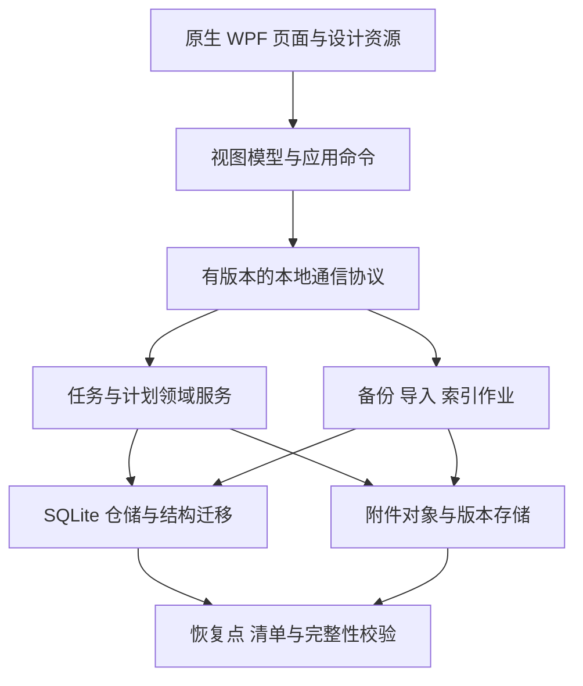

# TaskBoard 个人专业版产品与质量方案

编制日期：2026-10-19。基线：3.0.1，仓库文档提交 `02f2e24`，应用实现提交 `30f1810`。

目标用户：自己长期使用，优先考虑效率、稳定和数据安全。本文是建设方案；新增功能、性能数值和质量门槛均为拟定目标，不代表当前已经实现或测量达标。本轮核查采用源码与既有验证记录，没有重新执行 Windows 实机测试。

## 1. 产品定位与建设原则

打造一款能够长期保存工作资料、快速组织任务、可靠安排时间的原生 Windows 个人工作台。

- 保持独立 Windows 桌面程序，采用原生控件；无需浏览器、WebView、账户注册或联网即可完成全部核心工作。
- 延续 3.0.1 的紫色 T、深色侧栏、浅色内容区及统一中文字体。所有新页面遵循同一套设计规范。
- 数据由用户掌握：可查看位置、备份、完整导出、迁移和恢复。
- 操作结果清晰：区分未保存、草稿已保存、正式保存、保存失败、恢复中。失败后有可执行的下一步。
- 常用操作直接完成，高级功能逐步展开；每项功能同时设计键盘路径、失败处理与恢复路径。
- 继续保留 GitHub EXE 分发。签名方案另行决定，不把证书申请作为本方案实施前提。
- 保留手动检查清单，不重新引入此前移除的任务模板体系。

“高标准”在本文中落实为可重复验证的产品质量目标。参考 Windows 原生交互与 UI Automation、WCAG 2.2 中适用于桌面软件的指标及 WCAG2ICT 指导、可靠数据存储和依赖维护实践；这些不构成已通过某项认证的声明。

## 2. 当前已具备的能力

已有功能应保留并深化，升级和迁移必须覆盖这些行为的回归。

| 能力 | 当前状态 | 进一步完善的方向 |
| --- | --- | --- |
| 任务与看板 | 固定三列、拖动排序、四级优先级、日期、归档、回收站 | 项目、自定义流程、列表、真正子任务 |
| 今日计划 | 今天到期、逾期、主动加入今日；不改变截止日期 | 今日重点、个人排序、计划日期和容量 |
| 标签与视图 | 颜色、计数、合并、基本筛选、保存视图 | 多条件检索、跨页面搜索、视图管理 |
| 检查项与里程碑 | 手动检查项、卡片进度、全部完成提示、任务内里程碑 | 有独立日期和状态的子任务、项目级里程碑 |
| 重复与依赖 | 日／周／月、两种重复基准、防重复生成；依赖防环、阻塞完成 | 序列管理、复杂频率、双向关系和影响预览 |
| 提醒 | 当天／提前一天、指定时刻、稍后提醒、托盘气泡 | 独立提醒时间、提醒中心、唤醒补发、原生通知 |
| 附件 | 拖入、截图粘贴、大小、名称搜索、图片切换、版本文字 | 流式暂存、真实版本链、缩放、附件中心 |
| 编辑保护 | 两秒草稿、关闭恢复、批量编辑、短时撤销、操作记录 | 正式版本历史、差异比较、冲突合并 |
| 数据管理 | 启动日备份、完整 ZIP、迁移预览、附件校验、诊断、CSV／Excel 导出 | 定时与外部备份、单任务恢复、保真导出与合并导入 |
| 桌面交付 | 自包含 EXE、托盘、单实例、安装卸载保留数据、实际 Windows 截图 | 稳定 Release 下载、可靠升级、完整设备与输入法验收 |

## 3. 当前最值得补齐的差距

| 编号 | 核查结论 | 对长期使用的影响 | 建议优先级 |
| --- | --- | --- | --- |
| G01 | 当前密码仅限制应用入口，数据库、附件和 ZIP 未加密 | 需要保密时，文件复制到其他位置仍可能被读取 | P1；P0 先明确安全边界 |
| G02 | 自动备份只在数据引擎启动时触发，默认同目录保留 7 份 | 连续运行不能持续产生日备份；同盘故障可能同时影响原件和备份 | P0 |
| G03 | 数据恢复有普通异常回滚，但跨数据库／附件替换没有持久恢复阶段记录 | 进程强杀或断电后的完整恢复尚无充分保障 | P0 |
| G04 | 私有引擎请求单队列，无超时和取消 | 长操作或无响应可能阻塞后续草稿、保存 | P0 |
| G05 | 操作日志与短时撤销不能恢复此前正式保存的正文、检查项版本 | 发现错改较晚时，需要整个工作区回滚才能找回内容 | P0/P1 分步完成 |
| G06 | 快照读取所有任务、归档与回收站；搜索重建全部卡片 | 长期积累后可能变慢，刷新可能影响滚动和焦点 | P0 做基准，P1 完成改造 |
| G07 | 没有项目对象、真正子任务和列表视图 | 多店铺、多类型工作混在一个看板，复杂任务拆解不足 | P1 |
| G08 | 缺少完整键盘操作体系；真实 IME、高 DPI、多显示器仍未验收 | 高频操作效率和中文输入体验缺少发布保障 | P0/P1 |
| G09 | 3.0.1 下载入口主要是 Actions 制品，更新和回退依靠手工步骤 | 长期下载地址、升级安全与版本追溯需要产品化 | P0/P1 |
| G10 | 原生目标框架为 .NET 8，接近其支持截止时间 | 需要安排受支持运行时迁移及自包含包补丁更新 | P0 |

以上是实现与验证差距，不表示已经发生过数据损坏、失窃或性能故障。

P0：发布质量基础。P1：个人专业版核心能力。P2：完成核心后增加的效率增强。优先级按收益、风险与依赖排序，不按界面是否显眼排序。

## 4. 推荐的信息架构与视觉方向

### 4.1 导航

侧栏主入口：收件箱、我的今天、近期计划、所有任务。其下是收藏项目、全部项目、常用视图。归档、回收站、恢复中心与设置放在次级区域；草稿待处理时显示数量提示。

项目中提供看板／列表切换；全局提供列表／日历／议程。打开不同视图读取同一份任务数据，不生成任务副本。

建议布局：

```text
┌────────────┬──────────────────────────────────────────┐
│ 紫色 T     │ 当前项目 / 工作台      搜索 Ctrl+K  新建 │
│ 收件箱     ├──────────────────────────────────────────┤
│ 我的今天   │ 看板 · 列表 · 日历    筛选摘要 / 结果数  │
│ 近期计划   ├─────────────────────────┬────────────────┤
│ 所有任务   │ 任务内容                │ 原生详情面板   │
│            │ 保留滚动和选择          │ 标题 / 状态    │
│ 收藏项目   │                         │ 日期 / 项目    │
│ 常用视图   │                         │ 内容与子任务   │
│            │                         │ 附件 / 历史    │
│ 数据与设置 │                         │ 保存状态/保存  │
└────────────┴─────────────────────────┴────────────────┘
```

这是一份布局草图；实际交付仍需原生 Windows 页面截图验证。

### 4.2 界面规范

- 默认保留现有视觉方向，统一颜色、字体层级、间距、圆角和焦点样式。正文默认约 14–16 逻辑像素，次要信息也须满足对比度要求。
- 提供舒适／紧凑密度、浅色／深色／跟随系统、统计区显示开关。偏好跨重启保存。
- 卡片首先展示标题、优先级、日期和必要进度；次要操作放菜单。状态同时用文字或图标表达。
- 默认详情采用可调宽的原生右侧面板，约 420–520 逻辑像素；窄窗口切换为完整详情页面并保留返回位置。独立详情窗口作为可选操作。
- 日期选择器延续轻量中文月历与今天／明天／一周后／清除；新增时间功能放可展开区域。
- 加载、空列表、无搜索结果、错误、离线和恢复状态均有设计，不用原始 JSON 或异常堆栈作为主要提示。
- 备份状态集中在恢复中心；正常使用时只在失败、即将影响数据安全等需要行动的情况下提示。

### 4.3 键盘与中文输入

| 操作 | 建议键位 |
| --- | --- |
| 搜索与命令面板 | Ctrl+K |
| 当前列表搜索 | Ctrl+F |
| 新建任务 | Ctrl+N |
| 正式保存 | Ctrl+S；可兼容 Ctrl+Enter |
| 返回／关闭面板 | Esc；先保留草稿 |
| 列表选择／打开任务 | 上下方向键／Enter |
| 撤销 | Ctrl+Z；文本输入中优先撤销文字 |

可选全局快速录入热键支持更改和冲突检测，默认不开启。不得抢占 Windows 快捷键。

中文候选期间的 Enter 只确认选词；文字提交后再次 Enter 才创建任务。组合输入期间不重建搜索结果、不卡候选窗。输入框中保留文字选择、撤销、粘贴的原生行为。

## 5. 任务组织：从单看板到个人工作台

### F01 收件箱与快速捕获 · P1

随手记录的想法进入收件箱，可暂时没有项目、标签和日期。提供“移到项目”“安排今天”“稍后处理”，无须一次填完所有字段。

快速输入可逐步支持“明天下午 3 点整理新品图片 #设计”一类确定性解析，提交前用可移除的日期／标签标记展示结果；解析不了时保留原文。此能力可完全本地实现。锁定工作区时先解锁，不将录入内容写入未加密的绕过入口。

验收：纯键盘完成捕获和归类；只创建一项；中文选词不误提交；切换项目不丢内容。

### F02 项目与可配置流程 · P1

项目包含名称、目标、颜色、开始／目标日期、项目备注、归档状态。示例项目：“阿里新店运营”“独立站上新”“商品视觉”。任务默认属于一个项目，标签用于跨项目分类。

每个项目可配置列名和顺序，例如“待整理→制作中→待确认→已完成”。底层仍使用待办／进行中／完成／取消等明确状态类型，以统一重复任务、统计和完成规则。可选在制任务数量提示，超出时提醒，默认不强制阻止。

迁移：旧任务放入“原工作看板”项目；原三列映射保留，排序、日期、标签及附件不改变。删列前必须选择任务迁往何处；归档项目不删除任务。

归档项目默认退出活跃视图、今日与提醒，暂停该项目的周期实例调度；归档前展示未完成任务及跨项目依赖影响。解除归档时按错过周期策略预览处理，不立即补出大量历史实例。已完成的归档任务仍可满足其下游依赖，未完成的归档任务继续显示阻塞原因。

验收：自定义列改名不改变完成语义；移动任务先预览跨项目状态映射；搜索、今日和项目页面指向同一任务。

### F03 真正子任务 · P1

保留轻量检查清单，另提供具有独立标题、状态、日期、优先级、说明、附件和提醒的子任务。首版界面只开放父任务＋子任务两级，防止个人工作结构过深。

父任务显示子任务完成比例与检查清单比例，两种进度分开标注。子任务可单独加入今日；完成父任务时若存在未完成子任务，展示处理选项。取消的子任务不混算为完成。

推荐默认规则：父子任务属于同一项目；跨项目移动默认移动整个子树，单独移动子任务时先解除父关系。父任务完成遇到未完成子任务时默认拦截，可返回处理子任务或显式选择批量完成；不得静默替用户完成。父任务删除／归档涉及子任务时，以预览后的一个操作组执行并提供恢复路径。

检查项可转换为子任务。反向转换时预览将无法保留的字段，支持取消。父子结构单独检查层级循环；实际导致“必须等待另一项才能完成”的规则组成完成阻塞图，再检测混合等待循环。普通父子关系和软关联不能直接当作双向硬依赖。

验收：父子关系不成环；父任务恢复时子任务关联完整；同一子任务在各视图计数不会被无说明地重复累加。

### F04 全局搜索、列表与常用视图 · P1

- Ctrl+K 搜索任务标题、正文、检查项、标签、项目、附件名称；显示命中位置并高亮。
- 活跃、归档、回收站有明确范围开关，默认不把已删除任务混入普通结果。
- 支持多标签、排除条件、日期范围、无日期、被阻塞、含附件；简单模式保留常用选项，高级条件按需展开。
- 保存视图支持命名、复制、覆盖、重排和删除；保存“本周”时存相对规则，而非固定日期。
- 列表可选显示项目、状态、优先级、日期、进度、预计时长等列；支持宽度和顺序记忆、就地编辑、批量操作。

查询引擎应验证中文连续子串、短词、全半角和大小写行为。不能只启用默认英文分词就宣称完成中文全文搜索。可采用合适的 FTS 分词与短查询回退策略；索引是可重建派生数据。

验收：“本周高优先级且非完成，含运营或设计标签”的条件可读、可编辑、可复用；清除筛选可一步返回；修改一项不打断列表位置。

## 6. 时间管理与任务规则

### F05 我的今天、周计划和时间块 · P1/P2

明确区分：

- 截止日期／时间：最晚什么时候交付。
- 计划日期／时段：准备什么时候做。
- 提醒时间：希望什么时候收到提示。
- 重复规则：如何产生后续实例。

今日分为“主动计划”“今天到期”“已逾期”，一项任务只出现一次，并可显示多个来源标记。可标记最多 3 项今日重点、手动排序、填写预计时长。预计安排超过可用时间时温和提示。

新增周／议程视图，月历继续保留。把任务拖到某天默认修改计划日；修改截止日期是独立操作，完成后可撤销。未完成今日计划可选择结转、重新安排或移出今日，不静默改截止日期。

时间块作为后续能力：任务可拆成多个工作时段，计划冲突可见；初期不要求计时器，也不将个人效率换算为绩效分数。

验收：跨午夜后今日规则正确；计划移动不改变截止日期；拖动和批量改日期有预览／撤销；明确全天日期与带时区时间的区别。

### F06 重复任务序列 · P1/P2

现有日／周／月重复继续保留，补充每 N 天／周、指定星期、周一至周五、每月第 N 个星期几、结束次数／日期、暂停与跳过本次。法定节假日和调休需单独、可更新的日历来源；“周一至周五”不可直接标成已支持中国法定工作日。

界面展示未来 5 次发生日期，编辑时明确“仅本次”或“本次及以后”。完成后重复以实际完成时刻为基准；固定日期系列按计划产生实例，允许上一期未完成，并用数量上限和可预览的补发策略避免积压爆炸。

迁移必须保持旧规则：3.0.1 的两种重复基准都在完成当前任务后才生成下一项；旧任务升级后仍保留原触发方式和截止日期锚定。按计划独立产生实例是新增模式，只能在用户查看未来实例预览后显式切换，不随升级自动启用。

错过周期默认跳到下个有效周期，用户可选择补发。月末沿用锚点回归规则。附件默认不复制；依赖选择“固定指向该任务”或“关联上一期”等显式规则，不静默继承错误对象。

验收：月末、闰年、跨年、夏令时、重开完成任务、重复点击完成、通信重试均不产生重复实例；撤销后系列状态一致。

### F07 依赖与关联 · P1

保留硬依赖防环和完成拦截，新增“我在等待谁”“哪些任务在等我”双向列表，一键跳转上游；上游完成后提示解除阻塞。另设“相关任务”软关联，不强制阻塞。

删除上游、取消任务、调整计划前显示受影响项。延期传播默认只给建议和预览，不自动修改全部下游截止日期。

取消或进入回收站的上游默认不满足硬依赖；下游提示解除或替换该依赖，不能自动解锁。取消不计为完成，已完成后归档的上游仍满足依赖。

首版使用清晰列表或小范围关系图；大型甘特图、资源调度和关键路径分析列为远期选项。

### F08 提醒中心与 Windows 通知 · P1

提醒可独立于截止日期设置，支持多个时间、稍后、已处理和直达任务。集中显示待处理提醒，支持免打扰、同类合并、隐私模式。

分阶段交付：先完善应用运行时的提醒中心和休眠唤醒补发，再接入可交互的 Windows 通知。开机启动和托盘常驻由用户选择。工作区锁定时默认只给通用提示、不泄露标题；加密模式下若不能安全读取调度信息，延后到解锁后补发。

完全退出后的提醒必须单独采用 Windows 支持的调度或后台方案，并验证取消、改期、重启、夏令时及权限行为后才可标为支持。界面始终说明当前提醒运行模式，不将托盘隐藏误称为完全退出。

验收：睡眠唤醒不会通知轰炸；错过提醒可合并补发；已处理提醒不重复；不允许运行中的旧调度覆盖刚刚改期的任务。

### F09 周回顾与个人洞察 · P2

展示本周完成、进行中滞留、主动延期、待整理收件箱、下周到期及重点。支持导出个人周报。

先建立明确的完成、重开、取消和延期事件，再计算趋势。说明时间范围、时区、子任务计数及重复实例规则，不直接用当前状态反推历史。首版避免虚假的“效率评分”和没有统计定义的图表。

## 7. 文件、编辑与数据可带走

### F10 附件中心和文件版本 · P1/P2

- 保留拖入、截图、名称搜索和图片切换，加入缩略图、缩放、100% 显示、适屏和平移。
- 用户点击后可用系统默认程序打开附件；解密后的外部副本需显示其实际保存位置和清理边界。
- 同一附件增加版本时保留旧内容、时间、备注和哈希；选择旧版恢复会建立新版本，不覆盖历史。
- 全局附件中心可按项目、任务、类型、名称筛选；孤立文件、缺失文件和重复内容有可解释的检查结果。
- 传输按字节显示进度，支持取消与重试。附件只暂存一次，草稿保存引用和元数据；避免反复把大文件 Base64 写进 JSON。
- 上限由实际内存、磁盘和恢复测试决定。先完成现有 100 MB 范围的真实验收，再评估更大附件。

验收：新增但尚未正式保存的图片也能预览；取消导入不删除用户源文件；版本恢复和任务恢复后附件仍可校验；大图与大文件不冻结界面。

### F11 正式版本历史、撤销与草稿合并 · P0/P1

每次正式保存形成可恢复版本，覆盖标题、正文、日期、状态、项目、检查项、关联及附件引用。历史显示时间和字段差异，支持恢复单任务或恢复为新任务。

恢复旧版会生成新版本，保留恢复前内容；涉及重复任务、依赖和已删除对象时先验证并展示冲突。自动历史不恢复本地文件系统里已被用户永久清除的原始内容，保留策略须与附件版本共同设计。

短时撤销继续保留，扩展为有版本检查的操作组。批量操作显示成功／失败项目，对已被后续修改的任务提供冲突处理，不回滚掉新工作。文本框中的 Ctrl+Z 仍处理文本。

草稿与正式版本有冲突时提供字段对照、保留双方或另存新任务；不再只能让用户关闭编辑器重来。草稿保存成功须由持久写入确认，失败保留内存内容与可复制入口。

建议历史策略：保存最近 90 天并至少保留每任务最近 20 个版本；允许调整容量上限。清理前显示对恢复能力的影响，不能静默清除唯一恢复副本。

### F12 完整导出与合并导入 · P1

现有 CSV／Excel 是摘要导出，保留其用途并明确标识。增加有版本说明的 UTF-8 JSON＋附件包，完整携带项目、任务、子任务、标签、检查项、依赖、重复、日期、备注和附件索引；Markdown 作为可读副本。

CSV／Excel 导入提供字段映射、编码和日期预览、逐行错误报告。结构化包支持导入到新项目或合并当前数据。用稳定 ID 和版本判断重复，不仅根据标题匹配；用户选择跳过、建立副本或解决差异。

完整备份与内容导出是不同操作：备份包含恢复工作区所需的数据；内容导出默认不包含密码验证信息、密钥或本机凭据。加密工作区导出明文时明确显示导出范围和目标。

验收：结构化导出后导入隔离工作区，字段和附件哈希一致；原工作区不受影响；关系无法映射时给出具体项，不静默丢失；取消导入后可回到原状态。

## 8. 数据可靠性：专业版的基础

### Q01 数据与恢复中心 · P0

统一显示数据位置、占用空间、最近成功备份、下次计划、备份目标可用性和恢复验证结果。允许选择外部磁盘或用户指定目录。

备份建议：

- 有变化时默认每 10 分钟触发轻量恢复点，给复制与校验保留时间；重大升级、迁移和整库替换前创建安全备份。
- 日备份保留 7 份、周备份 4 份、月备份 12 份，并设置可见的容量管理规则；最近恢复点按最近 24 小时保留。
- 大附件按不可变对象保存，恢复点引用已校验的对象，避免每 15 分钟重复压缩所有文件。面向导出的完整备份必须自包含；增量仓库必须校验清单和引用闭包，不能孤立分发一个依赖基础包的文件。
- 默认配置可先使用本地目录；首次设置建议选择独立磁盘。恢复中心说明实际备份保护范围，目标离线时显示最后成功时间并在重新连接后补做。
- 备份用数据库一致快照＋附件清单＋内容哈希＋结构版本。成功状态须在完整校验后显示。
- 快照固定同一逻辑版本的数据库与附件／历史引用清单。附件对象不可原地覆盖；快照开始时固定其对象引用，完成或安全取消前禁止回收这些对象。垃圾回收必须同时检查活跃任务、草稿、版本历史、进行中的作业和所有保留恢复点，不能因当前任务删了附件就删除仍被备份引用的内容。
- 定期在隔离临时目录执行真实恢复演练；恢复默认先打开副本预览，再由用户选择替换当前数据。
- 新恢复点完成验证后才轮换旧恢复点；取消、失败和强杀重启均须验证引用闭包，不能清除仍被保留恢复点需要的对象。

拟定目标：在应用运行、目标可用且任务量不超过验证规模时，正式提交的新变更在 15 分钟内进入已完成验证的恢复点；10 分钟触发间隔以增量备份及校验在 5 分钟内完成为前提。分别显示本地恢复点与独立目标备份覆盖到的提交边界。没有新变更时显示“当前变更已备份”，不只因文件日期较早就误报失去保护。首次全备、大量新附件或繁忙时若超出预算，显示实际保护延迟和原因，不把“已开始备份”计作成功。目标离线、磁盘坏损等情况下不虚报满足目标。介质彻底损坏后的恢复能力取决于独立备份。

### Q02 中断可恢复的保存、迁移与恢复 · P0

引入持久操作记录、工作区代际目录与提交标记。文件先暂存并校验，数据库事务提交后才能显示正式保存成功；目录切换和文件落盘语义必须在 NTFS 上验证。启动扫描未完成操作，继续完成或恢复到上一个完整代。

恢复过程中限制写入；失败时保留旧数据和暂存信息供恢复中心处理。不能因为发现一份不完整库就自动建立空工作区并覆盖原路径。

在每个提交阶段注入进程强杀、磁盘满、权限不足和文件占用，验证重启后数据库与附件一致。已返回保存成功的内容在定义的故障模型内必须可读；无法确认结果的操作提供结果查询，不能直接重复执行。

### Q03 引擎通信与后台作业 · P0

为私有通信增加协议版本、请求 ID、结构化错误、操作期限、进度与取消。普通查询和保存有有界等待；备份、索引和导入属于可跟踪作业。恢复属于独占维护操作，界面明确告知暂时不可写。

写操作使用持久操作 ID。请求超时后先查提交状态，再决定继续等待或重试，避免重复建任务或重复生成周期实例。引擎重启成功前不得继续显示“数据已保存”。

故障状态保留当前输入、已保存草稿、复制内容和重试入口。错误日志只记录必要的错误码、操作类型、耗时与恢复阶段。

### Q04 加密工作区与加密备份 · P1

增加可选加密工作区，覆盖数据库、附件、草稿、历史、搜索索引及应用管理的临时文件。加密备份支持在新电脑上独立恢复。

采用维护中的成熟加密数据库与文件加密库；可评估 SQLCipher 和认证加密文件格式。数据库、文件、备份均有明确的密钥管理方案，不自行设计密码算法或只隐藏文件扩展名。

设计要求：随机数据密钥、成熟口令派生、密码包装、单独恢复密钥、格式版本和完整性校验；改密码优先重新包装密钥。Windows 账户保护用于本机便利解锁时，必须同时保留可迁移恢复路径，不能只依赖本机 DPAPI。

旧备份记录密钥代际与包装方式。修改当前密码不会自动改变已导出的历史备份，也不能撤销已复制到外部的旧包；恢复旧包需使用对应口令或恢复密钥。提供对可访问旧备份重新封装并验证的流程，验证新副本前保留原恢复路径。恢复密钥轮换和疑似泄露后的完整数据密钥轮换属于独立操作，不能与普通改密码混为一谈。

从明文迁移时先创建独立加密副本，完整验证后切换；旧明文副本的保留和清理由用户明确选择。不能承诺在 SSD 上可靠擦除历史明文，也不能保证操作系统分页、休眠文件或第三方打开的副本均受应用控制。必要时结合 Windows 磁盘加密保护整机存储。

工作区闲置、Windows 会话锁定后可自动锁定。自动锁定优先保全草稿；恢复密钥只展示给用户，不放入诊断报告。遗失全部解密凭据时不能恢复数据，应在启用时演练恢复流程。

验收：错误密码和篡改文件被拒绝；关闭后不能在受应用管理的存储中读出指定测试内容；重装系统／新电脑恢复、改密码、迁移中断均通过。保护目标为离线文件访问，不宣称能抵御已控制当前解锁账户的恶意程序。

## 9. 长期性能与架构方案

保留 WPF＋私有本地数据引擎＋SQLite 的基础，逐步建立清晰模块边界。已验证的业务逻辑优先复用。



- UI 逐步采用 MVVM、稳定集合和可测试命令，减少页面代码中直接拼装业务规则。
- 查询与修改分开：列表只加载摘要，详情、历史和附件按需读取；分页、虚拟化和增量通知替代全库快照刷新。
- 搜索提供取消、短延迟合并输入和 IME 组合保护；编辑一个任务不重新创建整个看板。
- 数据库显式记录结构版本、迁移历史和最低读写程序版本；日期、状态类型、完成时间、稳定 ID 和 revision 逐步结构化，避免重要规则长期藏在无约束 JSON 内。
- 新增模型包括项目、项目状态、父子关系、计划时段、重复系列／实例、提醒、任务版本、附件版本、备份清单及操作日志；视实际功能逐批迁移，禁止一次性改完所有结构再集中验收。
- 持久时间戳统一定义 UTC 存储和本地显示；全天日期保持纯日期；固定当地时刻的重复和提醒额外记录时区与夏令时处理规则。
- 数据与程序目录分离作为默认新安装方向：如 `%LOCALAPPDATA%\TaskBoard\Data`。旧版安装旁 Data 通过可预览迁移处理，保留显式 `--data-root` 支持；切换前核对现有路径避免建立两个空工作区。
- 用户选择网络盘或同步盘时，优先用于关闭且完整的备份包；不把正在写入的 SQLite 文件直接交给普通文件同步工具实现多设备同步。
- .NET 8 的支持截至 2026-11-10；运行时升级作为独立维护事项，目标在此之前完成迁移到 .NET 10 LTS 的验证与发布，不等待大规模功能版本。重新完成安装、原生控件、字体、托盘和旧系统兼容验证；支持范围变化须明确说明。自包含程序随应用更新修补运行时。

## 10. 可验收的性能与质量目标

以下均为立项门槛建议，先记录当前基线再校准。测试报告必须注明软件版本、机器、数据规模、冷热缓存、采样方式及异常值；不能把开发机偶测当成普遍承诺。

参考设备：Windows 11 x64、4 核 CPU、8 GB 内存、SSD、集成显卡；记录具体型号。标准数据集为 10,000 项任务、50,000 个检查项、10,000 条附件索引及至少 1 GB 实际附件，覆盖中文、归档、回收站、依赖和历史。压力集 100,000 项任务允许降速，但应可分页浏览且不崩溃。

| 维度 | 拟定验收门槛 |
| --- | --- |
| 启动 | 标准集冷启动到解锁页 P95 ≤ 3 秒；输入密码并通过验证后首个视图可操作 P95 ≤ 2 秒 |
| 输入反馈 | 常规键入反馈 P95 ≤ 50 毫秒，长作业期间仍可输入；无超过 100 毫秒的持续 UI 阻塞 |
| 搜索 | 输入提交后首屏结果 P95 ≤ 300 毫秒；分别记录合并输入等待与查询耗时 |
| 任务详情／保存 | 无新增大附件的详情打开 P95 ≤ 200 毫秒，正式保存 P95 ≤ 500 毫秒 |
| 长作业 | 显示真实进度或明确进行阶段，可取消的阶段提供取消；备份不长期阻塞普通编辑 |
| 草稿 | 普通编辑最后一次变化后约 2 秒完成持久化；未完成时不显示“草稿已保存” |
| 内存 | 标准集初步预算 UI＋引擎空闲工作集 ≤ 350 MB；最终以基准校准。反复开关详情／大图后内存回落，无持续增长趋势 |
| 稳定性 | 72 小时自动化持续使用与休眠唤醒；可恢复错误有提示，无静默数据丢失 |
| 故障恢复 | 定义的保存／恢复／迁移阶段强杀、磁盘满、文件占用场景全部通过；确认保存的数据与附件一致 |
| 备份 | 应用持续运行 48 小时仍按计划备份；目标断开／重连可见；完整恢复演练结果通过 |
| 中文输入 | 微软拼音、搜狗实际候选窗测试：选词、翻页、混输、粘贴、撤销、连续 Enter 不误建、不丢字、不闪候选窗 |
| 显示 | 100%、125%、150%、175%、200% DPI，文字放大，不同缩放双屏切换，拔掉副屏后窗口可找回 |
| 无障碍 | 键盘完成核心流程，焦点可见无陷阱，Narrator 正确朗读名称／角色／状态；适用的普通文本对比度 ≥ 4.5:1、控件与焦点 ≥ 3:1 |
| 安装升级 | 无 Python／.NET 的干净机器安装；上一稳定版升级；运行中升级、回退到独立旧数据副本；卸载保留数据哈希 |

测试分层包括业务规则、数据集成、故障注入、安装后 UI Automation、性能基准、真实输入法与显示设备手工验收。复用已有测试，不把“测试数量增加”当质量目标。

## 11. 发布、升级与可维护性

- 正式稳定版放到 GitHub Releases，提供 EXE、发布说明、支持系统、数据结构兼容范围、SHA-256 和签名状态。Actions 制品继续用于测试候选版本，不作为唯一长期下载入口。
- 不改动既有 2.0 基线 Release；新版本使用新标签，记录源码提交和构建流程。
- 应用内“检查更新”由用户主动触发，自动检查为可选；核心功能断网照常使用。
- 更新流程为版本说明→备份→关闭应用→运行安装器→首次启动健康检查。迁移失败保留旧数据副本，并显示明确的恢复入口。
- 旧程序发现未来结构时拒绝写入，不能在升级后的原库上冒险降级。回退针对旧程序与兼容的旧数据副本进行，需说明新版新增数据的处理方式。
- 当前未签名 EXE 保持明确标识和用户启动安装。校验和用于核对一致性，不冒充“已验证的发布者”。以后如完成签名可接入发布链，不承诺消除所有 Windows 下载来源或 SmartScreen 提示。
- 维护第三方依赖清单、许可证和 SBOM；CI 动作与依赖版本可追溯。正式开源许可证由权利人确认，不能为了签名直接代选。
- 本地环形诊断记录版本、错误码、耗时、操作 ID 和恢复阶段；默认排除任务内容、附件名称、完整路径和凭据。用户可预览并手动导出，不自动上传。
- 每版维护已知问题与支持范围，依赖补丁按风险安排发布。默认测试受支持的 Windows 11 版本；现有 Windows 10 兼容需求单独记录并实测，运行时升级前明确兼容变化。

## 12. 推荐交付顺序

版本号为规划建议，不代表已承诺发布日期。各阶段可以在独立分支并行开发，但须通过前置质量门槛后发布。

| 阶段 | 建议版本 | 核心交付 | 完成条件 |
| --- | --- | --- | --- |
| 维护先行 | 3.0.2 | 受支持运行时迁移、依赖补丁与正式 Release 下载入口 | 以 2026-11-10 支持截止前完成为目标；兼容、安装升级和原有行为回归通过 |
| A 可靠基础 | 3.1 | 定时／外部备份与恢复中心、中断恢复、RPC 有界等待与操作幂等、基础任务历史、不可变附件对象与引用保留、结构版本／revision／事件基础、IME／DPI／键盘规范 | 故障注入和真实升级通过；完成基准测量；原有功能回归和关键截图通过 |
| B 高效工作台 | 3.2 | 收件箱、项目／流程、两级子任务、列表、全局搜索／命令面板、视图管理、原生详情面板、性能改造、稳定身份与完整导出 | 一万任务基准达标；典型工作从捕获到完成可纯键盘执行；迁移与导出往返校验通过 |
| C 数据长期保障 | 3.3 | 可选加密工作区和备份、完整任务／附件版本恢复、草稿冲突合并、导入合并、可靠更新引导 | 新电脑恢复、改密、错误凭据、篡改和中断测试通过；可以恢复单任务而不回滚全库 |
| D 计划与复盘 | 3.4 | 周／议程／时间块、高级重复系列、独立提醒与 Windows 通知、依赖影响预览、周回顾 | 时间边界矩阵、睡眠唤醒、周期幂等、隐私通知和统计定义验收通过 |

若近期最关心的是保密，加密工作区的技术验证与 A 阶段并行，验证通过后将 C 阶段加密功能提前；不得在密钥恢复流程未完成时交付默认加密。

每阶段交付包包含：安装器、源码提交、更新说明、已知限制、迁移／恢复说明、测试证据和实际 Windows 截图。项目优先做完整的垂直流程，避免先把所有菜单摆出来再逐项补实现。

前置契约：A 建立结构版本、幂等操作、任务 revision，以及完成／重开／取消事件；附件不可变对象与引用保留先于历史恢复上线，C 再提供完整版本链界面。B 导出前确定全局稳定任务身份及关系映射，旧整数 ID 保留作本机展示，不用于判定跨库任务相同。D 开工前固定全天日期、带时区时刻、重复触发与发生时间规则，并建立边界测试数据。

## 13. 关键端到端验收故事

1. **快速开始一天**：收件箱录入 5 项→归入两个项目→选择今日重点→安排计划时间→完成一项→撤销→重新完成，全程可用键盘。
2. **处理上新工作**：建立上新项目→拆分图片／文案／发布子任务→发布依赖图片和文案→完成上游→从今日打开发布任务→记录附件版本→归档项目。
3. **晚发现错改**：任务已保存数日→查看历史差异→恢复一个旧版本为新版本→不改变其他任务→附件内容仍正确。
4. **意外退出**：编辑正文并加入图片→草稿确认保存→强制结束进程→启动恢复→内容、图片及正式版本区分清晰。
5. **恢复中断**：预览完整备份→替换过程各阶段强杀→重启进入恢复流程→最终为一个完整代→不建立空库覆盖旧数据。
6. **换电脑**：创建可迁移加密备份→新电脑安装→用口令或恢复密钥恢复→核对任务、关联和附件哈希→原电脑数据仍可使用。
7. **大量数据**：加载标准集→中文搜索→跳转归档结果→返回原列表位置→批量修改→取消一个附件导入，界面持续可用。
8. **跨周期提醒**：固定周一三五重复→周末休眠→周一唤醒→合并错过提醒→处理一项→系列不重复生成，改期取消旧通知。

## 14. 暂不纳入核心版本的方向

多用户共享、评论与 @人、权限体系、企业 SSO、多人实时同步、移动端、复杂甘特图、插件市场和云端 AI 助手作为未来独立评估项。当前个人版优先完成长期本机使用闭环。

若未来增加同步，先定义多副本冲突、附件同步、端到端加密和服务成本；不将同步目录中的数据库文件当成同步协议。若未来增加 AI，需独立选择服务与数据发送范围，核心操作仍可离线完成。

## 15. 开工前需要记录的产品决策

已确认：个人专业版、原生 Windows、保留 GitHub EXE、当前无自备签名证书、优先效率／稳定／安全。

可按本文推荐默认值推进后续设计：两级子任务、单项目归属、浅色内容区／深色侧栏、舒适密度、手动正式保存＋自动草稿、后台提醒可选、核心功能离线。

真正需要用户设置时再选择：外部备份位置、加密启用与恢复密钥、历史保留容量、开机启动、通知隐私、对外发布许可证。它们不阻止先完成 A 阶段的方案和基础工程。

## 16. 核查依据与参考

代码行号以本方案基线为准；后续修改可能移动。

| 结论 | 依据 |
| --- | --- |
| 当前功能、安装与实机验收边界 | [README](../README.md)、[验证记录](VALIDATION.md)、[3.0.1 说明](releases/3.0.1.md) |
| 搜索重建、固定状态、模态详情、提醒轮询 | [BoardWindow.cs](../native/TaskBoard/BoardWindow.cs)，约 21、41、128、153–183、225 行 |
| 现有过滤／视图、批量、月历与设置 | [WorkspaceTools.cs](../native/TaskBoard/WorkspaceTools.cs)，约 16、55、65、78 行 |
| 两秒草稿、附件整文件读取和 Base64、版本文字 | [TaskEditor.cs](../native/TaskBoard/TaskEditor.cs)，约 32、97、121、153 行 |
| 全量快照、事务保存、活动摘要 | [domain.py](../source/taskboard/domain.py)，约 25、57、139 行 |
| 重复、提醒、启动日备份、短时撤销 | [features.py](../source/taskboard/features.py)，约 74、107、137、198 行 |
| 普通 SQLite、口令验证、ZIP、恢复与摘要导出 | [storage.py](../source/taskboard/storage.py)，约 195、262、570、612、756 行 |
| 启动备份、批量快照、串行命令 | [native_worker.py](../source/taskboard/native_worker.py)，约 30、105、195 行 |
| 通信单队列与无期限等待 | [Rpc.cs](../native/TaskBoard/Rpc.cs)，约 29–43 行 |
| 当前原生框架与自包含构建 | [项目文件](../native/TaskBoard/TaskBoard.csproj)、[构建脚本](../scripts/build-native.ps1)、[Windows 工作流](../.github/workflows/native-windows.yml) |

参考资料：

- [.NET 官方版本支持表](https://github.com/dotnet/core/blob/main/release-notes/README.md)：本次已核对 .NET 8 支持截止 2026-11-10、.NET 10 LTS 支持截止 2028-11-14。
- [Windows 应用设计](https://learn.microsoft.com/en-us/windows/apps/design/)与[WPF UI Automation](https://learn.microsoft.com/en-us/dotnet/desktop/wpf/controls/ui-automation-of-a-wpf-custom-control)：用于原生交互和可访问性设计参考。
- [WCAG 2.2](https://www.w3.org/TR/WCAG22/)与[WCAG2ICT](https://www.w3.org/TR/wcag2ict-22/)：选择适用于非 Web 软件的可测试指标。
- [SQLite Online Backup API](https://www.sqlite.org/backup.html)：用于一致备份设计参考；现有实现已经使用该 API。

本文不包含对现有程序功能或数据的修改，也未提交证书申请、发布新版本或更改许可证。
